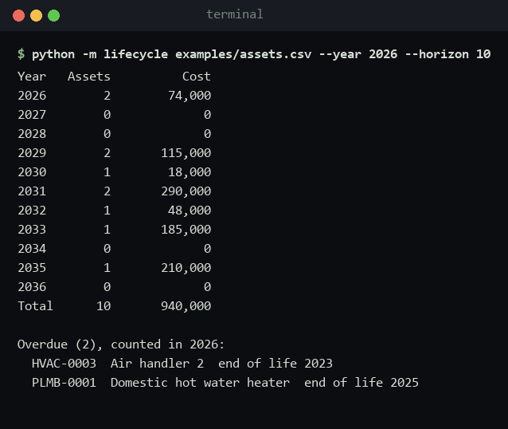

# asset-lifecycle-forecaster

Capital planning starts with one question: which assets reach the end of their expected life, and when. This tool reads an asset list with install year, expected life and replacement cost, and prints how many assets and how much money fall due in each year. Assets already past their life are listed separately and counted in the current year.



## What it is for

A building owner has dozens of air handlers, boilers, pumps and water heaters, each with an install year and a typical lifespan. Facility managers, maintenance planners and capital planners use this tool to turn that list into a year by year replacement budget. They get the number of assets and the total cost due each year, plus the list of assets that are already overdue.

## Install

```
git clone https://github.com/yassine2med/asset-lifecycle-forecaster
cd asset-lifecycle-forecaster
pip install -r requirements.txt
```

## How to use

| I want to | Command |
|---|---|
| Forecast replacements for an asset file | `PYTHONPATH=src python -m lifecycle examples/assets.csv --year 2026` |
| Set the current year (required, so results do not change on a later rerun) | `--year 2026` |
| Choose how many years after the current year to show (default 10) | `--horizon 10` |
| Show help | `PYTHONPATH=src python -m lifecycle --help` |

Input columns: `asset_id`, `name`, `category`, `install_year`, `expected_life_years`, `replacement_cost`.

Example:

```
PYTHONPATH=src python -m lifecycle examples/assets.csv --year 2026 --horizon 10
```

Output:

```
Year   Assets          Cost
2026        2        74,000
2027        0             0
2028        0             0
2029        2       115,000
2030        1        18,000
2031        2       290,000
2032        1        48,000
2033        1       185,000
2034        0             0
2035        1       210,000
2036        0             0
Total      10       940,000

Overdue (2), counted in 2026:
  HVAC-0003  Air handler 2  end of life 2023
  PLMB-0001  Domestic hot water heater  end of life 2025
```

Run the tests with `python -m pytest -q`.

## How it works

1. End of life year is install year plus expected life.
2. An asset with an end of life year before the current year is overdue.
3. Overdue assets are placed in the current year bucket.
4. Other assets go in the bucket for their end of life year.
5. Buckets run from the current year to current year plus the horizon. Assets that reach end of life later are left out of the table.
6. Costs are summed per bucket in the money given in the file.

## Limits

- No inflation, condition or risk adjustment. Every asset is replaced exactly at end of life.
- Replacement cost is taken as given and not escalated over time.
- A real plan should be checked against inspections; age alone is a rough guide.

## License

MIT. Yassine Emhamed, 2026.
